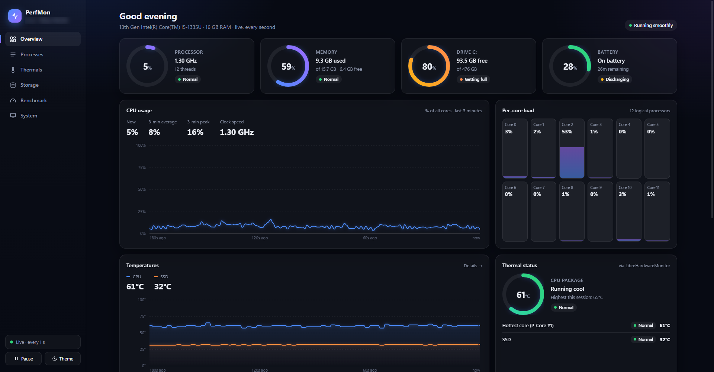
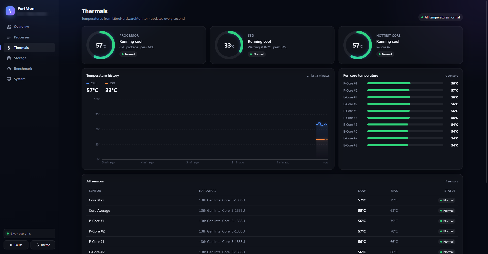

<p align="center">
  
</p>

<h1 align="center">PerfMon</h1>

<p align="center">
  A live performance monitor and benchmark for Windows laptops and PCs —<br>
  real-time graphs for CPU, memory, disk, network and battery in a clean desktop app.
</p>

<p align="center">
  
</p>

## Features

- **Live dashboard (1-second refresh)** — animated ring gauges for CPU, memory, system drive and battery, with a health badge that tells you at a glance whether the machine is running smoothly or under load.
- **Live graphs (last 3 minutes)** — CPU usage (with average, peak and clock speed), RAM and page file, disk read/write, and network download/upload. Hover any graph for exact values at that moment.
- **Per-core load** — a fill bar for every logical processor.
- **Temperatures** — CPU package, every P-/E-core, SSD (with its warning/critical limits) and GPU, with a live chart, peak values, a Thermals page listing every sensor, and Normal / Warm / Hot / Critical status. Requires [LibreHardwareMonitor](#temperature-monitoring).
- **Processes** — the top 15 apps by CPU or memory, with usage bars and a name filter.
- **Storage** — used / free space for every drive.
- **Benchmark** — a ~20 second test of single-core CPU, multi-core CPU, memory bandwidth and disk read/write speed, producing an overall score. Results are saved so you can track scores over time.
- **GPU** — utilisation, temperature and VRAM are shown automatically on machines with an NVIDIA GPU (`nvidia-smi`).
- **Dark and light themes**, native desktop window, no internet connection required.

## Install

Download `PerfMon-Setup-x.y.z.exe` from the [Releases](../../releases) page (or build it yourself — see below) and run it.

- No administrator rights needed (installs per-user by default).
- Optional desktop shortcut and "start when I sign in" option.
- Uninstall from **Settings → Apps** like any other program.

Requires Windows 10/11 (64-bit) with the Microsoft Edge WebView2 runtime, which is preinstalled on Windows 11.

## Temperature monitoring

<p align="center">
  
</p>

Windows doesn't provide a standard way for normal (non-admin) apps to read CPU temperature — reading it needs a low-level hardware driver. Rather than ship a driver and force PerfMon to run as administrator, PerfMon reads temperatures from the free, open-source [LibreHardwareMonitor](https://github.com/LibreHardwareMonitor/LibreHardwareMonitor), which runs in the background.

One-time setup:

1. Install LibreHardwareMonitor: `winget install LibreHardwareMonitor.LibreHardwareMonitor` (or download it from its releases page).
2. Start it and approve the admin prompt (it needs admin rights to read sensors).
3. In LibreHardwareMonitor, turn on **Options → Remote Web Server → Run** (default port `8085`).
   Optionally also enable **Options → Start Minimized**, **Minimize To Tray**, **Minimize On Close** and **Run On Windows Startup** so it stays out of the way.

PerfMon picks up temperatures within a few seconds — until then the dashboard shows a setup card with a **Start LibreHardwareMonitor** button. If LibreHardwareMonitor uses a different port, set `PERFMON_LHM_URL`, e.g. `http://127.0.0.1:8086/data.json`.

On machines with an NVIDIA GPU, the GPU temperature is shown even without LibreHardwareMonitor.

Temperature bands used for status: CPU — warm ≥ 80 °C, hot ≥ 90 °C, critical ≥ 95 °C. SSD — warm ≥ 60 °C, hot/critical at the drive's own reported warning/critical limits. GPU — warm ≥ 75 °C, hot ≥ 83 °C, critical ≥ 90 °C.

## Run from source

Requires Python 3.10+.

```bat
git clone https://github.com/Sachintha1994/perfmon.git
cd perfmon
pip install -r requirements.txt
python server.py
```

Or just double-click `run.bat`.

Options:

| Command | What it does |
|---|---|
| `python server.py` | Opens PerfMon in its own desktop window |
| `python server.py --browser` | Opens the dashboard in your default browser instead |
| `python server.py --page thermals` | Opens on a specific page (`overview`, `processes`, `thermals`, `storage`, `benchmark`, `system`) |
| `set PERFMON_NO_BROWSER=1` then `python server.py` | Runs the server only (headless) |

The dashboard is served on `http://127.0.0.1:8765` (or a free port if 8765 is taken). It only listens on localhost.

## Build the installer

```bat
build.bat
```

This will:

1. install the build dependencies (PyInstaller, Pillow),
2. draw the app icon (`packaging/make_icon.py`),
3. bundle `dist/PerfMon/PerfMon.exe` with PyInstaller,
4. compile `installer/PerfMon-Setup-<version>.exe` with [Inno Setup 6](https://jrsoftware.org/isinfo.php) (`winget install JRSoftware.InnoSetup`).

If Inno Setup isn't installed, step 4 is skipped and the portable app in `dist/PerfMon/` still works.

## How it works

```
┌──────────────────────────── server.py ────────────────────────────┐
│ Sampler thread ── psutil every 1 s ──► latest snapshot + 5-min    │
│   + temps from LibreHardwareMonitor     history buffer            │
│     (127.0.0.1:8085/data.json)                                    │
│ HTTP server (127.0.0.1)                                           │
│   GET  /                       dashboard (static/index.html)      │
│   GET  /stream                 Server-Sent Events, 1 msg/second   │
│   GET  /api/info               static system details              │
│   GET  /api/history            last 5 minutes of samples          │
│   GET  /api/temps/status       is LibreHardwareMonitor available  │
│   POST /api/temps/start-lhm    launch LibreHardwareMonitor        │
│   POST /api/benchmark          start a benchmark run              │
│   GET  /api/benchmark          benchmark progress / result        │
│   GET  /api/benchmark/history  saved benchmark runs               │
└───────────────────────────────────────────────────────────────────┘
            ▲                                     
            │  pywebview (Edge WebView2) desktop window
            │  — or any browser with --browser
```

- The UI is a single dependency-free HTML file; charts are drawn on `<canvas>`.
- Benchmark CPU and memory tests run in separate worker processes so the app itself doesn't skew the result.
- Benchmark history is stored in `%LOCALAPPDATA%\PerfMon\benchmarks.json`.

### About the benchmark score

The score is a simple weighted composite (single-core 30%, multi-core 35%, memory 15%, disk write 20%) scaled so that a typical mid-range laptop lands around 1000. It's meant for comparing runs **on the same machine** — e.g. plugged in vs. on battery, before vs. after a cleanup — not as an industry-standard benchmark. For best results, plug in the charger and close heavy apps. Disk read speed may be inflated by the Windows file cache.

## Project structure

```
perfmon/
├── server.py              # sampler, benchmark, HTTP server, desktop window
├── static/index.html      # the dashboard UI
├── requirements.txt
├── run.bat                # run from source
├── build.bat              # build exe + installer
├── packaging/
│   ├── make_icon.py       # generates icon.ico / icon.png
│   └── PerfMon.iss        # Inno Setup installer script
└── docs/screenshot.png
```

## Tech stack

Python · [LibreHardwareMonitor](https://github.com/LibreHardwareMonitor/LibreHardwareMonitor) (temperatures) · [psutil](https://github.com/giampaolo/psutil) · [pywebview](https://pywebview.flowrl.com/) · HTML/CSS/JavaScript (canvas) · PyInstaller · Inno Setup
